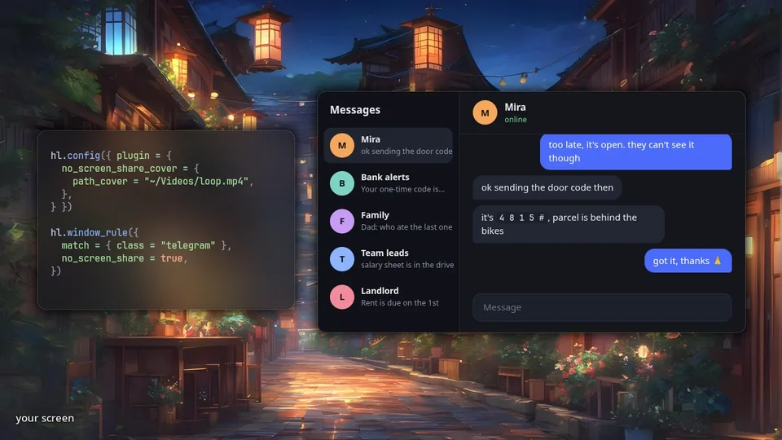

<div align="center">

# noshare-cover

**Приватным окнам необязательно быть чёрным прямоугольником на стриме.**<br>
Плагин Hyprland: в захвате экрана на месте каждого окна с `no_screen_share`
показывает картинку, GIF или видео.

[](LICENSE)


[](#установка)
[](#nix)

[Установка](#установка) · [Конфиг](#конфиг) · [Декод видео](#декод-видео) · [API](#api-для-других-плагинов) · [Архитектура](ARCHITECTURE.md) · [English](README.md)

</div>

<p align="center"></p>

## Что он делает

Hyprland умеет прятать окно от демонстрации экрана, и тогда зрители видят на его месте чёрный
прямоугольник. С этим плагином они видят то, что выбрал ты. На твоём экране ничего не меняется.

- **Любая обложка.** Картинка, GIF или видео (H.264, HEVC, AV1, VP8, VP9), по кругу и с нужной
  скоростью, одна на всё или своя для каждого окна.
- **Или вообще без файла.** `"blur"` и `"pixelate"` показывают само окно, но нечитаемым;
  `"transparent"` убирает окно из захвата, как будто его нет.
- **Дешёвое видео.** Декод на видеокарте (NVDEC, VA-API) с запасным путём на процессоре; кадр
  VA-API не покидает видеопамять, а экран перерисовывается, только когда у обложки новый кадр.
- **Маленький и самодостаточный.** Ядро на Rust (медиа, декод, часы воспроизведения, жизненный
  цикл, публичный API), тонкая прослойка на C++ для API плагинов Hyprland. Без FFmpeg, без
  cairo, без внешних процессов.
- **Безопасно перезагружать.** Многократные `hyprctl plugin unload/load` не оставляют потоков
  и памяти.
- **API для других плагинов**: обзор окон или переключатель тоже могут показывать обложки.

## Быстрый старт

```sh
hyprpm add https://github.com/MoonTiwzy/noshare-cover
hyprpm enable noshare-cover
hyprpm reload
```

```lua
hl.config({ plugin = { no_screen_share_cover = { path_cover = "~/.config/hypr/noshare-cover.gif" } } })
hl.window_rule({ match = { class = "^(org.telegram.desktop)$" }, no_screen_share = true })
```

Остальное (обложки по окнам, эффекты, выбор декодера) в разделе [Конфиг](#конфиг).

## Статус

> **Статус.** Работает целиком на живом Hyprland 0.57 (Arch): окно с
> `no_screen_share` в захвате `grim` закрыто обложкой (картинка, GIF, H.264, AV1, VP9),
> многократные `hyprctl plugin unload/load` не дают роста потоков и памяти
> (`tests/e2e/run.sh`). Собирается Nix-ом против Hyprland 0.57.0 (флейк hyprwm и nixpkgs) и
> makepkg на Arch. Hyprland 0.56 больше не поддерживается; на нём hyprpm собирает последнюю
> версию, которая его поддерживает (закреплена в `hyprpm.toml`). Декод через VA-API проверен на встройке AMD (radeonsi: H.264, VP9, AV1),
> в том числе с кадрами, которые не покидают видеопамять (`tests/e2e/video-memory.sh`);
> про NVDEC см. [Проверка GPU](#проверка-gpu).

## Декод видео

| | Кодеки | Откуда |
|---|---|---|
| NVDEC (NVIDIA) | H.264, HEVC, VP8, VP9, AV1 | `libcuda`/`libnvcuvid` из драйвера, dlopen |
| VA-API (Intel, AMD) | H.264, HEVC, VP8, VP9, AV1 (8 бит) | вшитый помощник на cros-codecs, нужен `libva` |
| CPU | AV1 | rav1d, вшит |
| CPU | H.264 | системный `openh264`, dlopen |
| CPU | VP8, VP9 | системный `libvpx`, dlopen |

`backend = "auto"` пробует видеокарту из `gpu_device` (без него: ту, которой рисует
композитор, а если она неизвестна, первый render node) и при неудаче переходит на CPU; `"gpu"`
на CPU не переходит никогда; `"cpu"` видеокарту не трогает. Отсутствие нужной библиотеки для
плагина не ошибка: он один раз скажет, какой пакет поставить, и возьмёт то, что есть.

Видео, декодированное через VA-API на той видеокарте, которой рисует композитор, не покидает
видеопамять: видеопроцессор карты превращает каждый кадр в RGB-картинку того размера, в котором
она показывается, и Hyprland берёт её как текстуру. Во всех остальных случаях (NVDEC, декодеры
на CPU, декодер на другой видеокарте) кадр переводится в BGRA на процессоре (с AVX2, если он
есть) и загружается в текстуру; видео, которое показывается меньше своего размера, сначала
уменьшается вдвое, поэтому 4K-ролик в маленьком окне стоит примерно столько же, сколько
маленький ролик. Если драйвер Hyprland не принял кадр из видеопамяти, обложка сама переходит
на второй способ.

Пока транслируется монитор с видео- или GIF-обложкой, плагин помечает её область изменённой
каждый раз, когда у обложки появляется новый кадр: с видео в 24 кадра монитор перерисовывается
24 раза в секунду, со статичной картинкой ни разу. Hyprland выдаёт кадры захвата только при
изменениях на мониторе, и без этого на статичном мониторе обложка в трансляции стояла бы.

## Конфиг

```lua
hl.config({
    plugin = {
        no_screen_share_cover = {
            -- png, jpg, jpeg, gif, mp4, m4v, mov, webm, mkv
            -- или "transparent", "blur", "pixelate" (см. ниже)
            path_cover = "~/.config/hypr/noshare-cover.gif",
            loop = true,
            speed = 1.0,
            -- декод видео: "auto" (GPU, если можно, иначе CPU), "gpu" (только GPU), "cpu"
            backend = "auto",
            -- render node для GPU; пусто = видеокарта композитора, иначе первый /dev/dri/renderD*
            gpu_device = "",
            -- сколько мс держать обложку после конца анимации закрытия окна
            close_hold = 0,
            -- каким программам захвата (имя exe) показывать скрытые окна как есть
            show_to = "",
            -- если задано, прятать только от этих программ, остальные видят всё
            hide_from = "",
            -- курсор остаётся виден поверх обложек, когда захват его показывает
            cursor_over_covers = true,
        },
    },
})
```

`path_cover` — обложка по умолчанию. Если он не задан, берётся первый существующий файл из
`~/.config/hypr/noshare-cover.{gif,jpg,jpeg,png,mp4}`; если нет ни одного, окна без своей
обложки просто получают чёрный бокс, без ошибки. `~` раскрывается.

Окну можно задать своё медиа, скорость и петлю правилом. Поля плагина плоские, обычные
Lua-имена, `hl.window_rule` принимает их напрямую, без обёрток:

```lua
hl.window_rule({
    match = { class = [[^(com\.ayugram\.desktop)$]] },
    no_screen_share = true,
    no_screen_share_cover = "~/.config/hypr/NoCover/67.mp4", -- медиа для этого окна
    no_screen_share_cover_speed = 1.5,                        -- необязательно
    no_screen_share_cover_loop = false,                       -- необязательно
    no_screen_share_cover_hold = 300,                         -- необязательно, вместо close_hold
})
```

Слои layer-shell (бары, лаунчеры, обои) так же, через layer rule:

```lua
hl.layer_rule({
    match = { namespace = "waybar" },
    no_screen_share = true,
    no_screen_share_cover = "~/.config/hypr/NoCover/bar.png",
})
```

Вместо медиа окну или слою можно задать `"transparent"`: его просто нет в захвате, будто его и
не было, и в стриме видно то, что под ним (скрытое окно под ним остаётся под своей обложкой). Это
для уведомлений, OSD и прочих всплывашек, которых в стриме быть не должно вовсе:

```lua
hl.layer_rule({
    match = { namespace = "notifications" },
    no_screen_share = true,
    no_screen_share_cover = "transparent",
})
```

`path_cover = "transparent"` делает так со всеми скрытыми поверхностями без своей обложки.
`show_to` и `hide_from` работают так же, как для обложек, анимация закрытия тоже пропадает из
захвата. Пока такая поверхность есть на захватываемом мониторе, каждый кадр захвата рисует этот
монитор ещё раз без неё: это один лишний рендер монитора на кадр захвата, а когда её нет, ничего.

`"blur"` и `"pixelate"` показывают картинку самой поверхности, размытую или пикселизованную:
в стриме видно, что там что-то есть, но не что. Число задаёт силу в пикселях захвата: размер
размытия (`"blur 40"`, по умолчанию 24) или размер блока (`"pixelate 32"`, по умолчанию 20).
Каждый блок это среднее пикселей под ним. Меню и подсказки такого окна получают тот же эффект.
Чтобы мелкий текст не читался, сила должна быть достаточной; формы и цвета размытая или
пикселизованная картинка всё равно показывает.

Программный курсор (`cursor:no_hardware_cursors`, обычное дело на NVIDIA) рисуется прямо в
картинку монитора, поэтому обложка над окном раньше закрывала и курсор. Теперь он рисуется
поверх обложек ещё раз; `cursor_over_covers = false` это выключает. Аппаратный курсор, который
попросил захват, и так всегда был сверху.

Программный курсор попадает в захват (в прозрачную сцену и поверх обложек), только если клиент
попросил курсор: `grim -c`, стрим со встроенным курсором. Буферы сцены (около 30 МБ на монитор
2560x1440: картинка и её стенсил, без которого блюр под слоем с `ignore_alpha` не работает; под
зумом курсора ещё 15 МБ) освобождаются через 10 с после последнего захвата,
которому они были нужны.

Имена полей из исходного плагина (`["no_screen_share_cover:path_cover"]`, `[":speed"]`,
`[":loop"]`) тоже работают.

Без `no_screen_share` окно не закрывается. Если совпало несколько правил, побеждает последнее.

Окно, лежащее поверх скрытого, остаётся видно в стриме: обложка (или чёрный бокс) рисуется только
там, где скрытое окно реально видно. Под полупрозрачным окном сверху обложка тоже рисуется, а само
окно рисуется заново поверх неё, со своей прозрачностью и блюром, так что сквозь него видна
обложка, а не скрытое окно. Слои над окнами (бары, лаунчеры, уведомления) так же рисуются поверх
обложки.

С `decoration:wobble` Hyprland гнёт окно, пока оно двигается. Обложка гнётся вместе с ним и точно
так же (она проходит через трансформеры самого окна), так что окно не выглядывает из-за
неподвижной обложки; окно, которое воблится поверх скрытого, рисуется поверх обложки заново,
согнутым как есть. `blur` и `pixelate` делаются из картинки кадра, где окно уже согнуто: они
ложатся на область, которую занимает согнутое окно. `decoration:motion_blur` не учитывается:
шлейф скрытого окна остаётся за пределами обложки.

При закрытии окна или слоя Hyprland подменяет его снимком для анимации закрытия, а на этот
снимок `no_screen_share` не действует, так что без плагина содержимое мелькает в стриме. Обложка
идёт за снимком до конца анимации и потом держится ещё `close_hold` мс (в правиле окна или слоя:
`no_screen_share_cover_hold`). `0` закрывает только саму анимацию.

Та же задержка работает, когда окно перестало быть скрытым, но осталось на экране, например
правило по заголовку перестало совпадать. Браузер сначала меняет заголовок и только потом
перерисовывается, поэтому при уходе с подходящей вкладки старая страница иначе попадает в стрим
на кадр-другой; для такого правила поставь `no_screen_share_cover_hold` (например, 300).
Программам из `show_to` не достаются ни эта задержка, ни обложка закрывающегося окна: они видят его как есть.

`hyprctl clients` и `hyprctl activewindow` (обычный вывод и `-j`) показывают, что плагин делает
с каждым окном:

```
	noScreenShare: 1
	noScreenShareCover: /home/me/.config/hypr/NoCover/67.mp4
```

`noScreenShare` говорит, скрыто ли окно от захвата, `noScreenShareCover` - чем оно закрыто:
файл, который играет, либо `transparent`, `blur 24`, `pixelate 20`. Пусто у скрытого окна значит
чёрный прямоугольник (обложка не задана и файла по умолчанию нет).

По умолчанию скрытые окна закрыты в любом захвате: и в стримах через портал (браузеры,
Discord, OBS через PipeWire), и у программ, которые снимают экран напрямую (grim,
wf-recorder, gpu-screen-recorder, OBS с wlrobs). Программа захвата определяется по её
исполняемому файлу (`/proc/<pid>/exe` Wayland-клиента). `show_to = "grim, hyprshot"` показывает
этим программам скрытые окна как есть, например для своих скриншотов. `hide_from =
"xdg-desktop-portal-hyprland"` наоборот: окна прячутся только от перечисленных (здесь только
от стримов через портал), а клиент, которого не удалось определить, всё равно видит обложку.
Имена через запятую или пробел. Если оба списка пустые, плагин клиента вообще не смотрит.

Имя подходит любому исполняемому файлу с таким именем; запись со слешем (`/usr/bin/grim`) это
полный путь, и она подходит только этому файлу. `~/` раскрывается, симлинки разворачиваются,
поэтому `/run/current-system/sw/bin/grim` или `~/.nix-profile/bin/grim` совпадают с путём в
сторе, откуда клиент запущен (путь перепроверяется раз в секунду, так что переключение NixOS
или обновление подхватываются). Пути с пробелами или запятыми указать нельзя. Если
`/proc/<pid>/exe` прочитать не удалось (`hidepid`, другой пользователь), плагин берёт имя
процесса из `/proc/<pid>/comm`. Его процесс ставит себе сам, поэтому такой клиент через
`show_to` не проходит никогда (об этом один раз на имя приходит уведомление), его сверяют только
с `hide_from`.

`show_to` это удобство, а не граница безопасности. Любая программа, запущенная от твоего
пользователя, может скопировать grim под именем из списка или запустить настоящий со своим
кодом (`LD_PRELOAD`), и тогда она видит то же, что grim. Плагин прячет скрытые окна от стримов
и записей, а не от программ на твоей машине.

Те же списки можно задать в правиле окна или слоя, тогда для этого окна действуют только они:

```lua
hl.window_rule({ match = { class = "org.telegram.desktop" }, no_screen_share = true,
    no_screen_share_show_to = "grim" })               -- на скринах видно, в стриме нет
hl.layer_rule({ match = { namespace = "waybar" }, no_screen_share = true,
    no_screen_share_hide_from = "xdg-desktop-portal-hyprland" })
```

Скрытый фоновый слой (например, обои) закрывается обложкой целиком, вместе с окнами поверх
него, так же как чёрный бокс самого Hyprland.

Зум курсора (`cursor:zoom_factor`) тоже учтён: в стрим идёт уже увеличенная картинка, а свои
чёрные боксы `no_screen_share` Hyprland ставит так, будто зума нет, и они мимо окон. Пока
монитор под зумом, плагин рисует все боксы сам там, где окна реально находятся: обложки или
обычный чёрный для окон (и их попапов) без обложки.

Ошибки (нет файла, неизвестный формат, битое видео, неверный `backend`) показываются
уведомлением Hyprland один раз, а не каждый кадр. Пропавший файл подхватывается сам, как
только появится.

Если плагин загружен через hyprpm, при старте Hyprland может показать `unknown config key
'plugin.no_screen_share_cover...'`: конфиг читается раньше, чем hyprpm грузит плагин. После
загрузки плагина Hyprland перечитывает конфиг, и ошибка уходит.

## API для других плагинов

Оверлеи с превью окон (например, gloview) могут попросить noshare-cover закрыть и их
прямоугольники: чёрным или той же обложкой, что у окна. Только заголовок, линковать ничего не
надо: [`include/noshare_cover_api.h`](include/noshare_cover_api.h).

```c
#include "noshare_cover_api.h"

static noshare_cover_api nsc;
static uint64_t          client;

// PLUGIN_INIT (или позже, когда noshare-cover появился)
if (noshare_cover_bind(&nsc) == 0) {
    client = nsc.register_client("my-overlay");
    // необязательно: узнать о выгрузке noshare-cover и не держать его в памяти
    if (nsc.set_gone_callback && nsc.set_gone_callback(client, on_gone, NULL))
        noshare_cover_drop_handle(&nsc);
}

// каждый кадр оверлея, на монитор: атомарно заменяет прямоугольники этого клиента на нём
noshare_cover_rect r = {x, y, w, h, rounding, window_address, NOSHARE_COVER_FILL_WINDOW};
nsc.set_rects(client, monitor_id, &r, 1);

// оверлей закрылся:  nsc.set_rects(client, monitor_id, NULL, 0);
// PLUGIN_EXIT:       nsc.unregister_client(client); noshare_cover_unbind(&nsc);
```

Координаты — глобальные пиксели раскладки (то же пространство, что позиция и размер окна).
У каждого клиента свои прямоугольники, один плагин не сотрёт чужие. `on_gone` вызывается
из `PLUGIN_EXIT` noshare-cover уже после снятия его хука `renderMonitor`: забудьте все
указатели на его функции. Функции v1 `noshare_cover_clear_extra_rects` /
`noshare_cover_add_extra_rect` работают как раньше.

Если `renderMonitor` уже перехвачен другим плагином (gloview делает так, пока noshare-cover
не загружен), noshare-cover не отказывается от загрузки, а ждёт, пока тот отпустит функцию.
gloview отпускает её сам, как только видит noshare-cover, так что порядок загрузки неважен.

## Зависимости

**Для сборки**

| Что | Зачем | Arch | Nix |
|---|---|---|---|
| `cargo` / `rustc` (1.89+) | ядро на Rust | `rust` | есть во флейке |
| компилятор C++ (C++26), `make`, `pkg-config` | прослойка для Hyprland | `base-devel`, `pkgconf` | есть во флейке |
| заголовки Hyprland | API плагинов | `hyprland` (hyprpm ставит свои) | из пакета Hyprland |
| `nasm` | ассемблер для декодера AV1 (rav1d) | `nasm` | есть во флейке |
| `libva`, `gbm` | с ними линкуется помощник VA-API | `libva`, `mesa` | есть во флейке |

`make NSC_VAAPI=0` собирает без VA-API; тогда libva и gbm не нужны. `make` сначала
всё проверяет и пишет, чего не хватает.

**Для работы** (всё необязательно, плагин грузится и без этого)

| Что | Для чего | Arch |
|---|---|---|
| драйвер NVIDIA (`libcuda`, `libnvcuvid`) | декод на видеокарте NVIDIA (NVDEC) | `nvidia-utils` |
| `libva` + драйвер VA-API | декод на видеокарте Intel/AMD | `libva` + `mesa` / `intel-media-driver` |
| `openh264` | H.264 на процессоре | `openh264` |
| `libvpx` | VP8/VP9 на процессоре | `libvpx` |

AV1 на процессоре, картинки и GIF ничего дополнительно не требуют. В Nix `openh264` и
`libvpx` берутся из store, драйверы NVIDIA и VA-API — из системы (`/run/opengl-driver`).

## Установка

### hyprpm (Arch и другие)

Для сборки нужны `cargo`, `nasm` и `libva` (Arch:
`pacman -S rust pkgconf nasm libva`). Если чего-то нет, `make` сразу напишет, чего
именно и какой пакет поставить. Без VA-API: `make NSC_VAAPI=0`.

```sh
hyprpm add https://github.com/MoonTiwzy/noshare-cover
hyprpm enable noshare-cover
hyprpm reload
```

URL без `/` в конце: со слэшем hyprpm не может взять имя репозитория и ставит плагин мимо
своей папки. hyprpm собирает плагин против запущенного Hyprland и грузит его сам, отдельно
`hl.plugin.load` не нужен.

Первая сборка компилирует всё (больше всего времени уходит на ассемблер AV1-декодера). hyprpm
хранит папку сборки cargo в `~/.cache/noshare-cover/target` (~500 МБ), поэтому после
обновления Hyprland пересобираются только крейты этого репозитория и часть на C++, примерно
пятая часть первой сборки. Папку можно удалить, чтобы освободить место; следующая сборка
просто начнётся с нуля.

### Arch

`packaging/arch/PKGBUILD` (`makepkg -si`). Пересобирайте после каждого обновления
`hyprland`: плагин, собранный под другие заголовки, откажется грузиться, а не уронит
композитор.

```lua
hl.plugin.load("/usr/lib/hyprland/plugins/libnoshare-cover.so")
```

### Nix

Плагин нужно собирать ровно против того Hyprland, который запущен, иначе он не загрузится с
ошибкой `built for Hyprland <коммит>, running <коммит>`. Проще всего через модуль Home Manager:
он собирает против системного `programs.hyprland.package`, если включён модуль NixOS (это тот
Hyprland, что запускается через `/run/wrappers`), иначе против
`wayland.windowManager.hyprland.package`:

```nix
inputs.noshare-cover = {
  url = "github:MoonTiwzy/noshare-cover";
  inputs.nixpkgs.follows = "nixpkgs";
};
```

```nix
imports = [ inputs.noshare-cover.homeManagerModules.default ];
programs.noshare-cover.enable = true;
# добавляет его в wayland.windowManager.hyprland.plugins; грузить самому:
# "${config.programs.noshare-cover.package}/lib/libnoshare-cover.so"
```

Без Home Manager, на NixOS:
`inputs.noshare-cover.lib.mkNoshareCover pkgs config.programs.hyprland.package`.

Готовые пакеты подходят только под конкретные сетапы. `packages.default` собран против входа
`hyprland` этого флейка, так что он подходит, только если Hyprland запущен из того же входа
(добавьте `inputs.hyprland.follows = "hyprland"` и укажите его в `programs.hyprland.package`).
`packages.nixpkgs` собран против `hyprland` из nixpkgs, на котором залочен этот флейк. Есть и
`overlays.default` (`pkgs.hyprlandPlugins.noshare-cover`, собирается против `final.hyprland`).

Какой Hyprland запущен: `hyprctl version`.

## Проверка GPU

```sh
NOSHARE_COVER_DEBUG=/tmp/nsc.log Hyprland   # или экспортируйте в сессии
```

Поставьте `backend = "gpu"` и видео в `path_cover`, начните любой захват экрана и смотрите
`/tmp/nsc.log` и уведомление Hyprland: с `gpu` плагин на CPU не переходит, поэтому проблема
с видеокартой будет показана, а не спрятана. Полезно: `vainfo` (есть ли драйвер VA-API),
`nvidia-smi`. Строка `from video memory, buffer N imported: ok` в логе значит, что кадры
показываются без копирования в системную память.

`gpu_device` может указывать не на ту видеокарту, на которой идёт сессия: например, декодировать
обложки на встройке AMD или Intel, а NVIDIA оставить свободной (кадры тогда идут через системную
память). `LIBVA_DRIVER_NAME`, который на
системах с NVIDIA часто ставят в `nvidia`, в libva действует на все устройства; если он называет
драйвер другой видеокарты, плагин грузит родной драйвер устройства (radeonsi для AMD, iHD/i965
для Intel).

## Разработка

```sh
cargo test                 # ядро: конфиг, часы, медиа, демукс, декодеры, реестр, API, раскладка ABI
NSC_TEST_MEDIA=dir cargo test   # + настоящие файлы: h264.mp4, av1.mp4, vp9.webm (декод и проверка)
NSC_TEST_MEDIA=dir NSC_TEST_GPU=/dev/dri/renderD129 NSC_VAAPI_HELPER=target/release/libnoshare_cover_vaapi.so \
    cargo test --release        # + те же файлы на этой видеокарте через VA-API (сначала cargo build -p noshare-cover-vaapi)
tests/e2e/run.sh ./libnoshare-cover.so <каталог с роликами>        # живой Hyprland + grim, циклы unload/load
tests/e2e/with-gloview.sh ./libnoshare-cover.so ./gloview.so     # вместе с gloview
tests/e2e/hyprctl.sh ./libnoshare-cover.so       # поля плагина в hyprctl clients / activewindow
tests/e2e/wobble.sh ./libnoshare-cover.so        # обложки гнутся с decoration:wobble, из-за них ничего не видно
tests/e2e/pump.sh ./libnoshare-cover.so          # трансляция получает кадры в темпе самой обложки
tests/e2e/video-memory.sh ./libnoshare-cover.so  # кадры VA-API из видеопамяти выглядят как с CPU
cargo clippy --all-targets -- -D warnings
make                       # libnoshare-cover.so (заголовки Hyprland через pkg-config; NSC_VAAPI=0 без VA-API)
nix build                  # герметичная сборка + тесты
```
